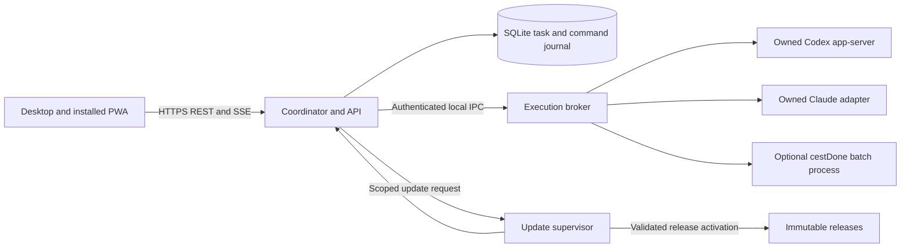

# Architecture and process ownership

## Chosen system

No cloud relay is required for version 1. A private HTTPS endpoint may use an operator-configured Cloudflare Tunnel or VPN. This changes reachability only; application authentication remains required. Do not expose provider servers, terminals, IPC sockets, or database files through the web endpoint.

## Implementation module map

Use `apps/server/src/{auth,authority,commands,db,events,intents,projects,scheduler,verification,voice,notifications,updates}` for the corresponding services, with no HTTP handler containing orchestration logic. Put transition schemas in `packages/contracts/src`, provider implementations in `packages/adapters/src/{codex,claude,cestdone,fixture}`, process ownership and receipt journals in `apps/broker/src`, and activation/recovery in `apps/supervisor/src`. Keep UI features in `apps/web/src/features/{today,tasks,decisions,assistant,settings,updates}` and shared theme tokens in `apps/web/src/styles/tokens.css`. Co-locate unit tests; keep cross-process integration tests in `tests/integration` and browser journeys in `tests/e2e`. This map is a required initial structure, with later extraction allowed when documented.

## Processes

| Process | Owns | Must survive / limitation |
|---|---|---|
| Coordinator | HTTP, SSE, task state, decisions, intent interpreter, scheduler, notifications | May restart during an update; all durable state is in SQLite. |
| Broker | Provider children, exact session mapping, process handles, tool policy, command receipt journal | Survives ordinary coordinator/UI updates; never depends on an HTTP request staying open. |
| Supervisor | Stable launcher, release validation, activation journal, health checks, rollback | Lives outside release directories. Ordinary self-improvement cannot edit it. |
| Browser/PWA | Rendering, drafts, device settings, audio capture/playback | Closing the browser cannot stop host work. No provider credential or execution authority is stored in JS. |

Run under the operator's identity, not the existing SYSTEM cestDone daemon. Version 1 supports a locked desktop with that user session running. Sign-out/sleep is a documented availability boundary until tested otherwise. A sign-in startup task is an opt-in installer operation; no administrator privilege is needed for a loopback development instance.

Use a local named pipe with an owner-restricted ACL on Windows for coordinator/broker/supervisor IPC. Include protocol version, request ID, installation ID, and a per-install protected challenge token. On unsupported platforms use an owner-only Unix socket. No TCP fallback that listens on all interfaces. Prove ACL behavior with a separate process test; if isolation cannot be established, fail startup.

## Persistence and roots

The development checkout contains source, specs, and fixtures only. The default operator state root is `%LOCALAPPDATA%/cestOn/`, with `state/`, `logs/`, `releases/`, `staging/`, `backups/`, and `supervisor/`. Resolve the real identity's home directory; do not bake in Daniel's path. Allow an explicit absolute data root. Reject a data root inside a source checkout or cloud-synchronized folder.

SQLite runs in WAL mode with foreign keys enabled, transactional migrations, a single coordinator writer, a 5-second busy timeout, and bounded queries. The broker uses a separate append-only receipt journal with checksummed records and periodic atomic compaction. Broker acknowledgement includes its durable receipt sequence. SQLite recovery reconciles that sequence after restart.

Retain run summaries and decisions for 180 days by default, raw provider event extracts for 7 days, local audio only until transcription completes, and three verified release bundles. Active/unreconciled commands, pending updates, and the current rollback pair are never pruned. Cleanup is deterministic and age-based, uses validated roots, and logs counts rather than content.

## Workspace and resource ownership

Register absolute canonical roots through local setup; the browser selects opaque project IDs afterward. Resolve junctions/symlinks before path checks; use Windows case-insensitive comparisons. The registry records display name, kind (`git` or `documents`), root, allowed child roots, source policy, and execution profile.

Grant a single writer lease per canonical checkout or document root. A Git repository may use separate task worktrees, but shared external resources and deployment environments still need independent locks. A lease expires only after a broker process and command reconciliation; elapsed wall time alone is insufficient to release a possibly live writer. Record PID plus start time and ownership nonce to avoid PID-reuse mistakes.

Existing external IDE sessions are not covered by managed leases. Before an adoption or same-checkout write, require an explicit handoff and an inactive-owner check. When status cannot be proved, retain `observe_only` and offer an isolated new worktree with an evidence brief.

## State recovery and delivery

Persist command intent and an outbox record in one transaction. Dispatch from the outbox to the broker using a stable command ID. Broker writes a receipt before starting a child and deduplicates IDs. On reconnect reconcile command, provider run, and workspace evidence. The system does not claim exactly-once arbitrary external execution; uncertain effects become `reconciling` or `needs_attention` and require read-back before another attempt.

Persist provider events with unique source IDs or per-run sequence numbers. Duplicate events are harmless. A completed transport stream without a verified terminal result is an interrupted run, not success. The scheduler resumes only eligible phases whose previous verification is current and whose limits and authority remain valid.

## Optional cestDone relationship

The local cestDone source at baseline has batch execution, a CLI, provider backends, and a daemon. It does not supply cestOn's durable task/decision/command API. Its daemon queue and operational configuration must remain independent. See `04-provider-adapters.md` for the subprocess adapter and limitations.

Do not import sibling TypeScript files or require a checkout at `../cestdone` in public installations. Accept an explicitly configured executable/version. An absent optional backend disables only its capability. The default managed workflow uses cestOn's own bounded phase scheduler and provider adapters.
